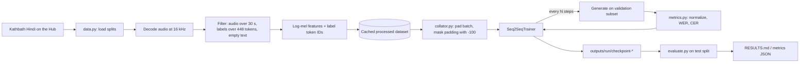

# Architecture: production Whisper Hindi fine-tuning

This document describes the target design for turning the proof of concept (`main.py` + `compare.py`) into a reproducible, resumable training and evaluation pipeline, and the steps to get there.

## Goals

- **Correct training:** shuffled data, warmup and decay of the learning rate, gradient clipping, length filtering, and validation during training with best-checkpoint selection.
- **Reproducible:** every run is fully described by a config file and a seed, and its metrics are logged.
- **Resumable:** a crashed or preempted run continues from its last checkpoint.
- **Honest evaluation:** the validation split is used to pick checkpoints, and a separate test split is used only to report final numbers.
- **Fits a single T4 (15 GB)** by default, and scales to bigger GPUs or the full dataset by changing the config only.

Non-goals for now: multi-GPU or multi-node training, serving infrastructure, and streaming (real-time) inference.

## Current state and what changes

| Area | Proof of concept | Target |
|---|---|---|
| Training loop | Hand-written loop in `main.py` | `Seq2SeqTrainer` |
| Configuration | Constants in the script | YAML config + command-line overrides |
| Data | Decoded and featurized inside the training loop, unshuffled | Preprocessed once with `datasets.map`, cached, shuffled by the trainer |
| Validation | Loaded but unused; scored afterwards by `compare.py` | Word error rate computed during training; best checkpoint kept; early stopping |
| Checkpoints | Weights only, one full copy per epoch | Weights + optimizer + scheduler + scaler + RNG state; limited number kept |
| Text normalization | Only in `compare.py` | Shared module used by training metrics and offline evaluation |
| Logging | `print` | `logging` + TensorBoard (optionally Weights & Biases) |
| Packaging | Top-level scripts; `poc:main` is a stub | Code in `src/poc/`, command-line entry points in `pyproject.toml` |

## Target layout

```
poc/
├── configs/
│   ├── t4_small.yaml          # current PoC setup: 2% of train, decoder only, fp16
│   └── full.yaml              # full train split, larger GPU
├── src/poc/
│   ├── __init__.py
│   ├── config.py              # typed config dataclasses, YAML loading, CLI overrides
│   ├── data.py                # load, filter, preprocess, cache the dataset
│   ├── collator.py            # pads audio features and labels per batch
│   ├── text.py                # Hindi-safe text normalization
│   ├── metrics.py             # word and character error rate for the trainer
│   ├── modeling.py            # load model and processor, freeze, set generation config
│   ├── train.py               # `poc-train` entry point
│   ├── evaluate.py            # `poc-eval` entry point (replaces compare.py)
│   └── transcribe.py          # `poc-transcribe` entry point for audio files
├── tests/
│   ├── test_text.py
│   ├── test_collator.py
│   └── test_smoke_train.py    # a few steps on a tiny slice with a tiny model
├── outputs/                   # run directories (git-ignored)
├── ARCHITECTURE.md
├── RESULTS.md
└── pyproject.toml
```

## Data flow



## Components

### `config.py`

Dataclasses for `DataConfig`, `ModelConfig`, and `TrainConfig`, loaded from YAML and overridable from the command line (for example `poc-train --config configs/t4_small.yaml train.learning_rate=5e-6`). The resolved config is written into the run directory so every checkpoint records exactly how it was produced.

Key settings, with defaults matching what fits on a T4:

| Setting | Default |
|---|---|
| `model.id` | `openai/whisper-large-v3-turbo` |
| `model.freeze_encoder` | `true` |
| `data.train_split` | `train[:2%]` |
| `data.eval_split` | `valid[:200]` (subset, to keep in-training evaluation fast) |
| `data.test_split` | Kathbath test split (confirm the exact split name) |
| `data.max_audio_seconds` | 30 |
| `data.max_label_tokens` | 448 |
| `train.per_device_batch_size` | 2 |
| `train.gradient_accumulation_steps` | 8 (effective batch 16) |
| `train.learning_rate` | 1e-5 |
| `train.warmup_ratio` | 0.1 |
| `train.lr_scheduler` | `linear` |
| `train.max_grad_norm` | 1.0 |
| `train.fp16` | `true` |
| `train.gradient_checkpointing` | `true` |
| `train.eval_steps` / `save_steps` | 200 |
| `train.save_total_limit` | 2 |
| `train.early_stopping_patience` | 3 evaluations |
| `seed` | 42 |

### `data.py`

- Loads the configured splits, renames `audio_filepath` to `audio`, and casts to 16 kHz audio.
- Drops rows with empty text, audio longer than 30 seconds, or transcripts longer than 448 tokens, and logs how many were dropped.
- Converts audio to log-mel features and text to label token IDs with `dataset.map(num_proc=N)`. The result is cached on disk, so the GPU never waits on audio decoding during training.

### `collator.py`

- Stacks the input features (fixed 30-second length for Whisper).
- Pads labels per batch and replaces padding with `-100`, using the attention mask because Whisper's pad token is also its end-of-text token.
- Strips the leading start-of-transcript token if present, since the model adds it.

### `text.py` and `metrics.py`

- `normalize()` removes Unicode punctuation and symbols and collapses whitespace, keeping Devanagari vowel signs (Whisper's `BasicTextNormalizer` strips them).
- `compute_metrics()` decodes predictions and labels, normalizes both, and returns word and character error rate via `jiwer`. The trainer uses word error rate to choose the best checkpoint.

### `modeling.py`

- Loads the processor with `language="hindi", task="transcribe"`.
- Loads the model, sets `use_cache=False` for training, and freezes the encoder if configured.
- Sets `generation_config.language = "hi"` and `generation_config.task = "transcribe"` so saved checkpoints transcribe Hindi without extra arguments.

### `train.py`

Builds `Seq2SeqTrainingArguments` from the config with `predict_with_generate=True`, `eval_strategy="steps"`, `load_best_model_at_end=True`, `metric_for_best_model="wer"`, `greater_is_better=False`, and `gradient_checkpointing_kwargs={"use_reentrant": False}` (needed with a frozen encoder). Adds `EarlyStoppingCallback`. Supports `--resume` to continue from the latest checkpoint in the run directory. At the end it saves the best model and processor to `outputs/<run>/best/`.

### `evaluate.py`

Replaces `compare.py`. Takes one or more model paths and a split, transcribes in batches with fp16 and greedy decoding, and writes word and character error rate plus sample transcriptions to `outputs/<run>/eval_<split>.json`. Used for final reporting on the test split.

### `transcribe.py`

Transcribes one or more audio files with a trained model, chunking audio longer than 30 seconds through the `pipeline("automatic-speech-recognition", chunk_length_s=30)` helper.

## Implementation steps

Each phase should leave the repo working and committed.

### Phase 0: baseline

1. Make the first git commit with the current PoC, and add `outputs/` and `whisper-hi/` to `.gitignore`.
2. Record the PoC numbers from `RESULTS.md` as the baseline to beat: 23.89% word error rate on `valid[:500]`.

### Phase 1: package skeleton and config

1. Create the `src/poc/` modules listed above as stubs.
2. Implement `config.py` and `configs/t4_small.yaml`.
3. Add entry points to `pyproject.toml`: `poc-train`, `poc-eval`, `poc-transcribe`. Remove the `poc = "poc:main"` stub.
4. Set up `logging` with a consistent format.

**Done when:** `uv run poc-train --config configs/t4_small.yaml --dry-run` prints the resolved config.

### Phase 2: data pipeline

1. Implement `data.py` with filtering and cached preprocessing.
2. Implement `collator.py`.
3. Move `normalize()` from `compare.py` into `text.py`.
4. Write `tests/test_text.py` (vowel signs survive normalization) and `tests/test_collator.py` (padding becomes `-100`, end-of-text token is kept, start token is stripped).

**Done when:** the tests pass and preprocessing logs the number of clips kept and dropped per split.

### Phase 3: training with the trainer

1. Implement `modeling.py` and `metrics.py`.
2. Implement `train.py` with warmup, decay, clipping, accumulation, fp16, checkpointing, in-training evaluation, best-model selection, and early stopping.
3. Seed everything through the trainer's `seed` argument.
4. Add `tests/test_smoke_train.py`: run a few steps with `openai/whisper-tiny` on about 8 clips and check that a checkpoint is written.

**Done when:** a full run with `t4_small.yaml` finishes, `outputs/<run>/best/` exists, and its validation word error rate is at or below the PoC's.

### Phase 4: resume and logging

1. Implement `--resume` and test it by stopping a run mid-epoch and continuing.
2. Turn on TensorBoard logging (`report_to=["tensorboard"]`) for loss, learning rate, gradient norm, word and character error rate.
3. Save the resolved config and the git commit hash into each run directory.

**Done when:** a resumed run's loss curve continues smoothly from where it stopped.

### Phase 5: evaluation and inference

1. Implement `evaluate.py` and delete `compare.py`.
2. Report final numbers on the test split, not the validation split used for checkpoint selection.
3. Implement `transcribe.py` with long-audio chunking.
4. Update `RESULTS.md` and the README's reproduce instructions to use the new commands.

**Done when:** `uv run poc-eval outputs/<run>/best --split test` writes a metrics JSON, and `uv run poc-transcribe file.wav` prints a transcript.

### Phase 6: scale up (optional)

1. Add `configs/full.yaml` for the full 91,752-clip training split.
2. If memory allows (bigger GPU, or LoRA via `peft`), try unfreezing the encoder.
3. Sweep the learning rate (for example 5e-6, 1e-5, 2e-5) and compare on validation.

## Open decisions

- **Trainer vs. hand-written loop:** this plan uses `Seq2SeqTrainer`. Keep the custom loop only if you need control the trainer can't provide.
- **Full fine-tuning vs. LoRA:** LoRA on both encoder and decoder may beat decoder-only full fine-tuning within the T4's memory.
- **Experiment tracking:** TensorBoard is the default; Weights & Biases is a one-line change if you want hosted dashboards.
